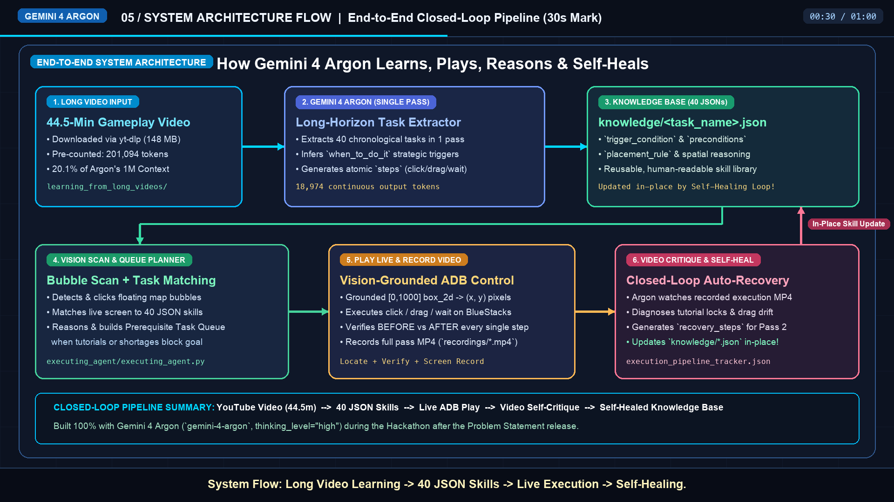

# SimCity BuildIt Autonomous Agent — Powered by Gemini 4 Argon

An autonomous closed-loop game agent built from scratch during the hackathon using **Gemini 4 Argon (`gemini-4-argon`)** that **Learns**, **Plays**, **Reasons**, and **Self-Heals**.



---

## 🎯 Problem Statement

Open-world 3D city-building games like **SimCity BuildIt** break traditional static bots due to shifting isometric cameras, floating 3D UI bubbles, multi-step material dependencies, and unexpected tutorial locks.

Our goal is simple: **Build an autonomous agent that can Learn from long human gameplay videos, Play live via vision-grounded control, and Self-Heal when unexpected blockers occur.**

> **Built at the Hackathon:** Both `learning_from_long_videos` and `executing_agent` were built from scratch during the hackathon using `gemini-4-argon` (`thinking_level="high"`) immediately after the problem statements were announced.

---

## 🏆 How We Address Both Hackathon Problem Statements

| Problem Statement | How Our Project Implements It | Verified Telemetry |
| :--- | :--- | :--- |
| **1. Million Token Engineering** | `learning_from_long_videos/long_video_agent.py` processes a **44.5-minute YouTube gameplay video (201,094 tokens)** in a **single pass** without chunking drift, generating **40 consistent JSON skill files** (`18,974` continuous output tokens). During execution, all 40 JSON files are loaded into context simultaneously (`~21K` text tokens/call) to match and plan multi-task prerequisite queues. | **201,094** pre-counted tokens in 1 pass → **40 JSON task files** in `333.9s` inference (vs. 6+ hours of manual scripting). |
| **2. More Dimensions** | `executing_agent/executing_agent.py` renders actions in the live 3D game via ADB, **continuously records an MP4 video of its own attempt**, uploads the video to `gemini-4-argon` (`video_critique_autofix`) to diagnose failures or tutorial blockers, executes recovery/prerequisite steps in a loop, and **rewrites its `knowledge/*.json` files in-place**. | **5 of 6** executed tasks automatically refined & self-healed across **703,680 total tracked tokens**. |

---

## 📂 Repository Structure

```text
├── README.md
├── requirements.txt
├── .env.example
├── system_flow_diagram.png                 # End-to-end architecture diagram
├── SimCity_Argon_Project_Demo.mp4          # 1-minute 1080p project demo video (with voiceover)
│
├── learning_from_long_videos/              # Module 1: Long-Video Skill Extractor
│   ├── long_video_agent.py                 # Downloads YouTube video, counts tokens & extracts tasks in 1 pass
│   ├── performance_logs.json               # Token & latency logs (201,094 input / 18,974 output tokens)
│   └── knowledge/                          # 40 structured task JSONs extracted by Gemini 4 Argon
│       ├── Place_and_Construct_Second_Residential_Zone_Using_Nails.json
│       ├── Build_Basic_Water_Tower_to_Resolve_Water_Shortage.json
│       ├── Build_Small_Factory_and_Produce_Metal.json
│       ├── Inspect_Growing_City_Journal_and_Build_Multi-Block_Road_Grid.json
│       └── ... (40 total JSON skill files)
│
└── executing_agent/                        # Module 2: Live Vision Executor & Self-Healing Loop
    ├── executing_agent.py                  # Bubble scanner, queue planner, ADB executor & video self-critique
    ├── execution_pipeline_tracker.json     # Before/After audit log of every self-healed workflow
    ├── performance_executing_argon.json    # Detailed per-call multimodal token & latency telemetry
    ├── new_steps.json                      # Latest matched/queued execution plan
    └── refined_steps/                      # Self-healed & refined task workflows
```

---

## ⚙️ How It Works

### 1. Learn (`learning_from_long_videos/long_video_agent.py`)
1. Downloads a 44.5-minute SimCity BuildIt gameplay video from YouTube using `yt-dlp`.
2. Uploads the video to the Gemini Files API and calls `count_tokens` with `gemini-4-argon` (**201,094 tokens**, 20.1% of Argon's 1M context window).
3. Decomposes the entire video in a **single pass** into **40 chronological task JSONs** inside `learning_from_long_videos/knowledge/`.
4. Each JSON captures:
   - `when_to_do_it`: `trigger_condition`, `strategic_reasoning`, `preconditions`, and `placement_rule`
   - `steps`: Ordered atomic actions (`click`, `drag`, `find`, `wait`) with target `who` and visual `briefing`.

### 2. Play & Reason (`executing_agent/executing_agent.py`)
1. **Live Bubble Scanner & Inspector:** Detects floating bubbles above buildings (hard-hats, `ZZZ` idle factory icons, collect items) in normalized `[0, 1000]` coordinates, clicks them, and inspects what popup or requirement opened.
2. **Strategic Task Queue Planner:** Matches the live screen against all 40 `knowledge/*.json` files. If a player's goal (e.g., `--goal "build a road"`) is blocked by an active tutorial mandate or resource shortage, Argon **reasons and prepares a multi-task prerequisite queue** (e.g., *Task 1: Forge Metal in Small Factory → Task 2: Upgrade Residential Zone → Task 3: Build & Extend Road*).
3. **Vision-Grounded ADB Execution:** Locates UI targets (`box_2d`) and executes taps/drags in BlueStacks via ADB, verifying **BEFORE vs. AFTER** screenshots on every step while recording the full pass to MP4.

### 3. Self-Heal (`video_critique_autofix`)
1. After each pass, the recorded gameplay MP4 is uploaded to `gemini-4-argon`.
2. Argon watches the video, identifies the exact timestamp and root cause of any failure (such as an advisor popup blocking road construction or drag coordinate drift), generates `recovery_steps`, and **updates the corresponding `knowledge/*.json` skill file in-place**.

---

## 🚀 Quick Start

### 1. Install Dependencies
```bash
python3 -m venv .venv
source .venv/bin/activate
pip install -r requirements.txt
```

### 2. Configure API Key
Copy `.env.example` to `learning_from_long_videos/.env` (or export in your shell):
```bash
export GEMINI_API_KEY="your_api_key_here"
```

### 3. Run Module 1: Learn from a Long YouTube Gameplay Video
```bash
python learning_from_long_videos/long_video_agent.py \
  --url "https://youtu.be/oEF69i-FkdA" \
  --approve single
```

### 4. Run Module 2: Execute Live & Self-Heal in BlueStacks
Ensure BlueStacks is running with ADB enabled (`127.0.0.1:5555`):
```bash
# Autonomous mode (scans live screen & matches best task from knowledge/)
python executing_agent/executing_agent.py --update-knowledge

# Goal-directed mode (plans prerequisite queue + target goal & self-heals)
python executing_agent/executing_agent.py --goal "build a road" --update-knowledge
```
